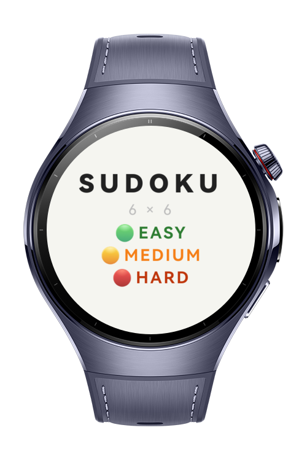
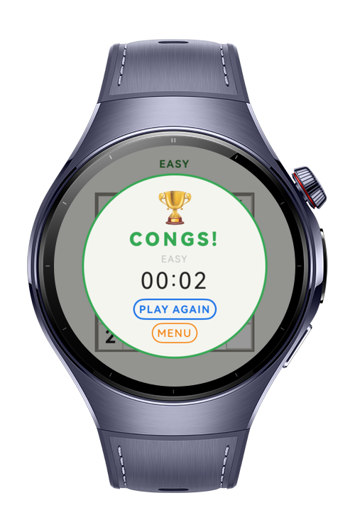
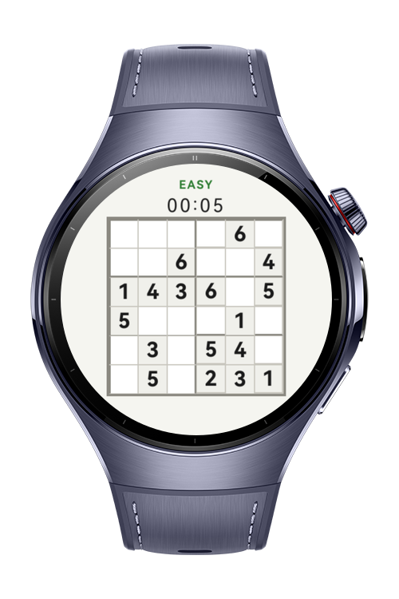
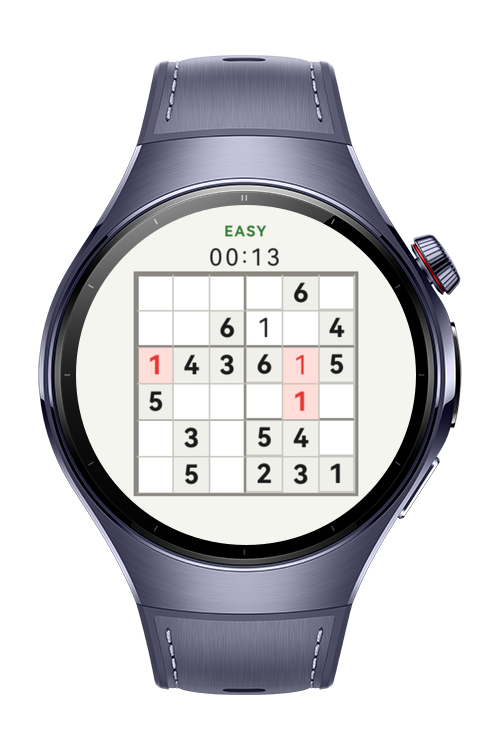

> **Note:** To access all shared projects, get information about environment setup, and view other guides, please visit [Explore-In-HMOS-Wearable Index](https://github.com/Explore-In-HMOS-Wearable/hmos-index).

# Sudoku
Sudoku 6×6 is a HarmonyOS Next wearable app that delivers a classic Sudoku puzzle experience optimized for round watch screens.
Users select a difficulty level (Easy, Medium, Hard), solve algorithmically generated 6×6 puzzles with unique solutions, and track their completion time. The app supports both touch input and digital crown rotation for number entry.
# Preview

<div>
  
  
  
  
</div>

# Use Cases
- Select a difficulty level: Easy, Medium, or Hard.
- Each game generates a fresh, algorithmically created puzzle with a guaranteed unique solution.
- Difficulty determines the number of empty cells:

  - Easy: 18–20 empty cells (16–18 given)
  - Medium: 20–22 empty cells (14–16 given)
  - Hard: 26–28 empty cells (8–10 given)

- Tap a cell to cycle its value (1→2→3→4→5→6→clear).
- Use the digital crown to adjust the selected cell's value (clockwise to increment, counter-clockwise to decrement).
- Real-time conflict detection highlights errors in rows, columns, and 2×3 boxes.
- A timer tracks elapsed time from game start.
- Win condition: all cells filled with no conflicts. A congratulations overlay shows the completion time with options to replay or return to the menu.
- Navigate through structured pages: Level Select → Game → Win Overlay → Level Select.

# Technology

## Stack
**Languages**: ArkTS

**Frameworks**: HarmonyOS SDK 5.1.0(18)

**Tools**: DevEco Studio Vers 5.1.0.842

**Libraries**: @kit.ArkUI, @kit.CryptoArchitectureKit

## Puzzle Generation Algorithm

Solution generation: Backtracking with Fisher-Yates shuffled candidate values (1–6) using cryptoFramework.generateRandomSync() (CSPRNG) for cryptographically secure randomness.
Puzzle creation: Iteratively removes cells from the complete solution in random order. After each removal, a recursive solver verifies the puzzle still has exactly one unique solution. If uniqueness breaks, the cell is restored.
Difficulty scaling: Controls how many cells are removed (Easy: 18–20, Medium: 20–22, Hard: 26–28).

# Directory Structure
```
entry/src/main/ets/
├── components/
│   ├── SudokuBoard.ets             # 6×6 grid container with ForEach rendering
│   ├── SudokuCell.ets              # Single cell with tap handler, border logic, state colors
│   └── TimerDisplay.ets            # MM:SS elapsed time display
│
├── models/
│   └── SudokuModel.ets             # Data models: Cell (@Observed), Level enum, LevelOption
│
├── pages/
│   ├── NavigationPage.ets          # Navigation root with NavPathStack routing
│   ├── LevelPage.ets               # Difficulty selection screen (Easy / Medium / Hard)
│   └── GamePage.ets                # Game screen (header, board, win overlay, crown input)
│
├── services/
│   └── NavigationService.ets       # Singleton navigation manager with NavPathStack
│
├── utils/
│   ├── SudokuColors.ets            # Light theme color palette constants
│   ├── SudokuGenerator.ets         # Algorithmic puzzle generation (backtracking + CSPRNG)
│   ├── SudokuValidator.ets         # Conflict checking, win detection, unique solution solver
│   └── GlobalContext.ets           # App-level context holder for UIAbility
│
├── viewmodels/
│   └── GameViewModel.ets           # Game business logic (MVVM): timer, cell management,
│                                   # crown handling, validation, win check
│
├── entryability/
│   └── EntryAbility.ets            # App entry point ability
│
└── resources/
    └── base/profile/
        └── main_pages.json         # Page routing configuration
```
# Constraints and Restrictions

## Supported Device
- Huawei Watch 5

# License

Sudoku is distributed under the terms of the MIT License.

See the [LICENSE](/LICENSE) for more information.